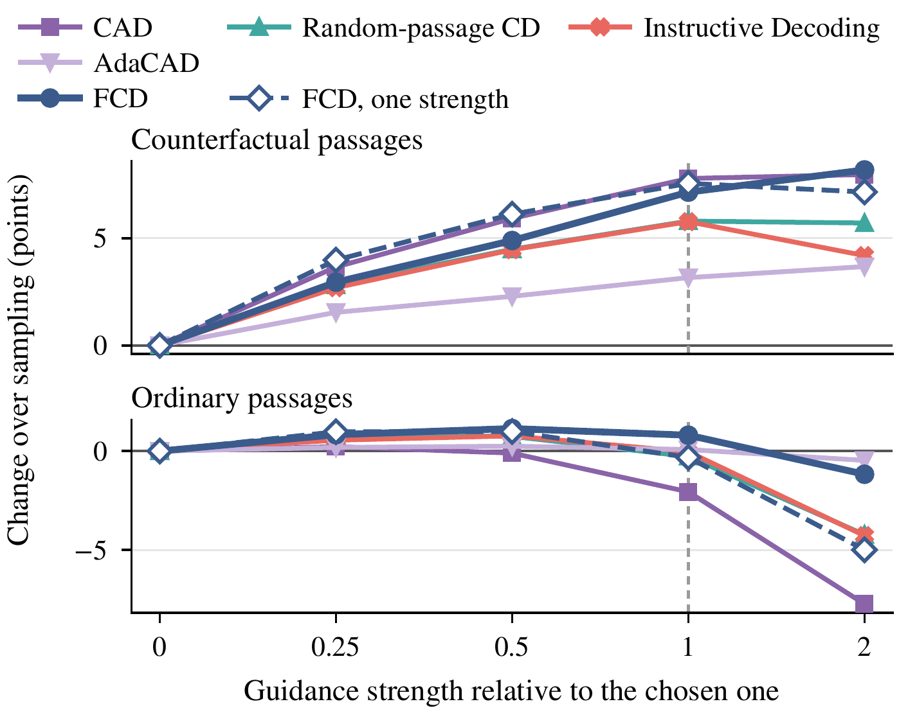

<h1 align="center">Two Views, Two Strengths:<br>Factorized Contrastive Decoding</h1>

<p align="center"><b>Context-faithful decoding for large language models, without training</b></p>

<div align="center">

[](LICENSE)
[](https://www.python.org/)
[](https://github.com/js-lee-AI/FCD/actions/workflows/ci.yml)
[](https://github.com/js-lee-AI/FCD/stargazers)

<b><a href="#quick-start">Quick start</a> · <a href="#usage">Usage</a> · <a href="#settings">Settings</a> · <a href="#results">Results</a> · <a href="#reproduce-table-1">Reproduce</a> · <a href="#faq">FAQ</a> · <a href="#citation">Citation</a></b>

</div>

<p align="center">
  
</p>

<p align="center"><em>Answers of Llama-3.1-8B on two test questions. The counterfactual passage contradicts the memorized fact and the ordinary one states it. Every other method misses at least one of the two; FCD follows both passages.</em></p>

---

## News

- **[2026-11-28]** Code released, with the per-example scores behind the main results.

## Overview

Large language models often return a memorized fact although the passage in their prompt updates or contradicts it. Contrastive decoding counters this by amplifying, at every token, the difference between the predictions under the full prompt and under a modified view of it. Most methods use one view, the question alone, which removes the passage and also rewrites the directive that refers to it, so it changes two parts of the prompt at once.

We split a prompt into four factors: the **directive** (what to do with the passage), the **format** sentence, the **evidence** (the passage) and the **question**. A matched view replaces exactly one factor and keeps the other three:

* **Directive view.** The directive "Answer the question using the passage" becomes "Answer the question using your own knowledge and ignore the passage".
* **Evidence view.** The passage is replaced by the passage of another example, which keeps the length, style and position of the evidence block but says nothing about the question.

Replacing one factor at a time shows that the passage moves predictions many times more than the directive, and that the directive acts mainly where the passage contradicts the memorized fact. **Factorized contrastive decoding (FCD)** therefore contrasts the full prompt with both views and gives each its own strength:

```text
s(y) = l(y) + gamma_D * (l(y) - l_D(y)) + gamma_E * (l(y) - l_E(y))
```

where `l`, `l_D` and `l_E` are the next-token log-probabilities under the full prompt, the directive view and the evidence view. Tokens are sampled from `s` with the model's usual temperature, top-k and top-p, and the sampled token is appended to all three prompts. One pair of strengths, `gamma_D = 1.0` and `gamma_E = 0.5`, serves all models and tasks.

Averaged over six models and five passage benchmarks, FCD gains 7.2 points over sampling on counterfactual passages and 0.8 points on ordinary passages, both with 95% intervals above zero, and its Mean of the two groups (71.5) is the highest of all compared methods. On the three held-out subsets of ConFiQA, where no setting was chosen, it gains 7.1 points.

## What it does in one picture

<p align="center">
  
</p>

<p align="center"><em>The full prompt and its two matched views. Each view replaces one factor; FCD adds the two contrasts with their own strengths and returns the passage answer where sampling returns the memorized one.</em></p>

## Quick start

```bash
git clone https://github.com/js-lee-AI/FCD.git
cd FCD
pip install -e .              # prompts, methods and tables (numpy only), CPU
python examples/quickstart.py
```

The quickstart prints the two views of the first question of the figure above and the answers that Llama-3.1-8B gave in the paper's runs, so it needs no model:

```text
NQ-Swap, a counterfactual passage: 'who wrote papa got a brand new bag'
  the passage says 'Michelangelo', the model has memorized 'James Brown'

[Full prompt]
  Answer the question using the passage. Reply with only the answer, a few words at most.
  Passage: `` Papa 's Got a Brand New Bag '' is a song written and recorded by Michelangelo . ...
  Question: who wrote papa got a brand new bag
[Directive view (directive replaced)]
  Answer the question using your own knowledge and ignore the passage. Reply with only the answer, a few words at most.
  Passage: `` Papa 's Got a Brand New Bag '' is a song written and recorded by Michelangelo . ...
  Question: who wrote papa got a brand new bag
[Evidence view (passage replaced)]
  Answer the question using the passage. Reply with only the answer, a few words at most.
  Passage: Stephanie Judith Tanner ( portrayed by Josh Brolin ) is the witty , sarcastic middle child of Danny ...
  Question: who wrote papa got a brand new bag

Answers of Llama-3.1-8B (seed 0), as recorded in the paper's runs
Method                 counterfactual passage             ordinary passage
Sampling               James Brown. (F1 0.00)             Dmitri Mendeleev. (F1 1.00)
CAD                    Michelangelo (F1 1.00)             No one (F1 0.00)
AdaCAD                 James Brown. (F1 0.00)             Dmitri Mendeleev (F1 1.00)
Random-passage CD      Michelangelo Brown. (F1 0.67)      Antoine-L Laurent de Lavoisier. (F1 0.00)
Instructive Decoding   Michelangelo (F1 1.00)             No mention. (F1 0.00)
FCD                    Michelangelo (F1 1.00)             Dmitri Mendeleev (F1 1.00)
```

To decode with a model, install the `run` extra (PyTorch, Transformers, Datasets) and pass a model:

```bash
pip install -e ".[run]"
python examples/quickstart.py --model llama3.1-8b
```

Llama-3.1-8B-Instruct is gated on the Hugging Face Hub: request access on its model page and log in with `hf auth login` before loading it. A live run can differ from the recorded answers in a cell or two, because bfloat16 kernels round slightly differently when the batch changes (see [Reproduce](#reproduce-table-1)).

## Usage

### Answer questions with a model

```python
from fcd import Example
from fcd.hf import FCD

fcd = FCD.from_pretrained("qwen3-8b")        # a short name of the paper or any Hugging Face id
ex = Example(
    question="who wrote the book the origin of species",
    passage="On the Origin of Species ... is a work of scientific literature by Donna Mills ...",
    partner_passage="The essential nature of the atomic nucleus was established with the discovery of the neutron "
                    "by James Chadwick in 1932 ...",      # any passage that says nothing about the question
)
print(fcd(ex, seed=0))
```

The evidence view needs `partner_passage`, the passage of another example. In the paper it is the passage of another question of the same task, and the task loaders of `fcd.data` fill it in. For a question of your own, any passage of similar length and style that says nothing about the question will do.

The strengths are arguments: `FCD.from_pretrained("qwen3-8b", gamma_d=2.0, gamma_e=0.5)`. For many questions, `fcd.generate(examples, seed=0)` decodes them in batches and returns the answers with the number of tokens processed.

A multiple-choice question lists its options, and the prompts label them A, B, C and so on:

```python
ex = Example(question="Which of the following would most likely form a fossil?", passage=passage,
             options=("a rock", "a crystal", "a mineral", "a bone"), partner_passage=other)
```

### Run the baselines

`fcd.hf.Decoder` holds a model with every decoder of the main comparison at its selected setting:

```python
from fcd.hf import Decoder
from fcd.methods import fcd_method

dec = Decoder.from_pretrained("llama3.1-8b")
out = dec.generate(examples, "cad", seed=0)            # sampling, cad, adacad, rpcd, id, fcd
print(out.texts, out.forward_tokens)
out = dec.generate(examples, fcd_method(1.0, 0.0), seed=0)   # FCD with one view: Instructive Decoding at 1.0
```

All decoders draw tokens with the same counter-based noise, a hash of the seed, the example uid, the step and the token. Two decoders that reach the same distribution at a step pick the same token, so their answers are paired example by example.

### See the views

The prompts need only the standard library:

```python
from fcd import views
for kind, text in views(ex).items():      # full, directive_view, evidence_view
    print(kind, text, sep="\n")
```

### Use the rule with another backend

The rule is a few lines over next-token log-probabilities, so it carries over to any backend that returns them for the three prompts with the same generated prefix:

```python
import torch
from fcd.decoding import make_rule
from fcd.methods import get_method

rule = make_rule(get_method("fcd"))
lp = torch.log_softmax(logits, dim=-1)    # [3, batch, vocab]: full prompt, directive view, evidence view
scores = rule(lp)                         # lp[0] + 1.0 * (lp[0] - lp[1]) + 0.5 * (lp[0] - lp[2])
```

### Command line

```bash
fcd demo                                     # the views and the recorded answers of the figure, no model
fcd table --per-model --heldout --intervals  # Table 1 from records/, CPU
fcd run --model qwen3-8b --out runs          # every method and seed on the eight tasks, GPU
fcd ask --model qwen3-8b --passage "..." --question "..."
```

`python -m fcd` runs the same commands.

### API at a glance

| Name | What it is |
|---|---|
| `Example(question, passage, options=(), partner_passage=None, ...)` | a question about a passage; options make it multiple choice |
| `views(example)` | the full prompt, the directive view and the evidence view |
| `fcd.hf.FCD` | FCD on a Transformers model, `fcd(example, seed)` or `generate(examples, seed)` |
| `fcd.hf.Decoder` | a Transformers model with every decoder of the paper, `generate(examples, method, seed)` |
| `fcd.methods.METHODS`, `fcd_method(gamma_d, gamma_e)` | the decoders, their views and selected strengths |
| `fcd.decoding.make_rule(method)` | the score function of a decoder over stacked log-probabilities |
| `fcd.data.load_split(task)` | development, test and scored examples of a task, from pinned dataset revisions |
| `fcd.table` | Table 1 from the records or from your runs |
| `score(reply, example)` | token F1 for short answers, accuracy for multiple choice |

## Settings

Every method uses the sampling settings of the model, and contrastive adjustments come before temperature scaling and filtering.

| Model | Temperature | Top-p | Top-k |
|---|---|---|---|
| Qwen3-1.7B, 4B, 8B, 14B (non-thinking) | 0.7 | 0.8 | 20 |
| Llama-3.1-8B-Instruct | 0.6 | 0.9 | off |
| Mistral-7B-Instruct-v0.3 | 0.7 | 0.9 | off |

Each method receives one strength, or one pair for FCD, for all models and passage tasks. One rule picks it on the development split: the strength whose gains over sampling in the two task groups have the highest mean, unless a strength recommended by the method's paper comes within 0.1 points of that mean.

| Method | Contrasted view | Selected | Strengths tried |
|---|---|---|---|
| CAD | the question alone | γ = 1 | 0.25, 0.5, 1, 2 |
| AdaCAD | the question alone | γ = 1, scaled by the Jensen-Shannon divergence at each step | 0.5, 1, 2, 4 |
| Random-passage CD | another example's passage | γ = 1 | 0.25, 0.5, 1, 2 |
| Instructive Decoding | the opposite directive | γ = 2 | 0.25, 0.5, 1, 2, 4, 8 |
| **FCD** | the opposite directive and another example's passage | γ_D = 1, γ_E = 0.5 | γ_D in 0.25, 0.5, 1, 2, 4, 8 and γ_E in 0.25, 0.5, 1 |

The development score of FCD is flat around the chosen pair, so a coarse grid on a small development split is enough. Answers are limited to 48 new tokens, 32 for multiple choice. Models run in bfloat16 with SDPA attention, loaded at the Hub revisions of the paper's runs (`fcd.models.REVISIONS`).

## Results

<p align="center">
  
</p>

<p align="center"><em>Change over sampling as each strength grows from zero to twice the chosen one (the vertical line), averaged over six models and three seeds. FCD scales its two strengths together; the dashed curve gives both of its views one strength.</em></p>

### Main comparison (paper Table 1)

Test scores averaged over six models and three seeds: F1, or accuracy for FaithEval. Mean averages the two groups, and ConFiQA averages its three subsets, which were held out from the choice of every setting. Parentheses give the difference from sampling, with \* when its 95% paired cluster-bootstrap interval excludes zero.

| Method | NQ-Swap | FaithEval | Counterfactual | NQ-Orig. | SQuAD | HotpotQA | Ordinary | Mean | ConFiQA (held out) |
|---|---|---|---|---|---|---|---|---|---|
| Sampling | 56.9 | 63.6 | 60.3 | 76.0 | 84.5 | 63.5 | 74.7 | 67.5 | 63.1 |
| CAD | 62.4 | 73.7 | 68.1 (+7.8\*) | 72.5 | 84.6 | 60.8 | 72.6 (-2.1\*) | 70.3 (+2.9\*) | 66.6 (+3.5\*) |
| AdaCAD | 61.4 | 65.5 | 63.4 (+3.2\*) | 75.6 | 85.5 | 63.2 | 74.8 (+0.1) | 69.1 (+1.6\*) | 65.7 (+2.5\*) |
| Random-passage CD | 61.0 | 71.1 | 66.1 (+5.8\*) | 75.4 | 85.3 | 62.5 | 74.4 (-0.3) | 70.2 (+2.8\*) | 67.8 (+4.6\*) |
| Instructive Decoding | 64.3 | 67.8 | 66.0 (+5.8\*) | 74.8 | 85.6 | 63.6 | 74.7 (0.0) | 70.4 (+2.9\*) | 69.4 (+6.3\*) |
| **FCD** | **64.9** | 70.0 | 67.4 (+7.2\*) | **76.3** | **86.4** | **63.8** | **75.5 (+0.8\*)** | **71.5 (+4.0\*)** | **70.3 (+7.1\*)** |

FCD is the only method that gains significantly on both groups, and its Mean is above that of every baseline with a 95% interval above zero: by 1.1 points over CAD and Instructive Decoding, 1.2 over Random-passage CD and 2.4 over AdaCAD.

### Mean of each model

| Method | Qwen3-1.7B | Qwen3-4B | Qwen3-8B | Qwen3-14B | Llama-3.1-8B | Mistral-7B |
|---|---|---|---|---|---|---|
| Sampling | 65.1 | 68.1 | 72.2 | 72.2 | 69.5 | 57.7 |
| CAD | 65.3 | 70.6 | 76.2 | 75.5 | 72.3 | 62.3 |
| AdaCAD | 65.9 | 69.4 | 73.3 | 73.2 | 71.9 | 60.9 |
| Random-passage CD | 65.8 | 70.4 | 74.3 | 74.6 | 71.2 | 65.1 |
| Instructive Decoding | 62.9 | 71.9 | 75.5 | 75.4 | 71.4 | 65.1 |
| **FCD** | 65.5 | 71.9 | 75.5 | 75.3 | 74.1 | 66.5 |

### ConFiQA, held out

| Method | ConFiQA-QA | ConFiQA-MR | ConFiQA-MC | Average |
|---|---|---|---|---|
| Sampling | 71.6 | 61.9 | 55.9 | 63.1 |
| CAD | 75.6 | 65.6 | 58.6 | 66.6 (+3.5\*) |
| AdaCAD | 73.9 | 64.3 | 58.7 | 65.7 (+2.5\*) |
| Random-passage CD | 75.9 | 66.2 | 61.2 | 67.8 (+4.6\*) |
| Instructive Decoding | 77.4 | 67.8 | 63.1 | 69.4 (+6.3\*) |
| **FCD** | **78.1** | **68.5** | **64.2** | **70.3 (+7.1\*)** |

`tests/test_paper.py` checks every number of these tables, the significance marks and the comparison of FCD with each baseline from the records.

## Reproduce Table 1

### From the records, on a CPU

`records/` holds the per-example scores of every method, model and seed on the scored test examples, and the development, test and scored uids of each task with the cluster labels used by the bootstrap. They rebuild the tables above and their significance marks exactly:

```bash
fcd table --per-model --heldout --intervals
python experiments/table1_main.py
pip install -e ".[test]" && pytest tests/test_paper.py
```

### From scratch, on a GPU

```bash
pip install -e ".[run]"
python experiments/run_main.py --models qwen3-8b --out runs     # resumes where it stopped
python experiments/table1_main.py --runs runs --models qwen3-8b
```

`fcd run` and `experiments/run_main.py` load each task from the Hugging Face revision that the paper used and draw the same 200 development and 800 test examples. Test examples whose question, or for SQuAD whose passage, also occurs in the development split are left out of the scores, which keeps 724 of the 800 on NQ-Swap, NQ-Original and SQuAD. ConFiQA keeps the questions whose modified and original answers differ and whose passages have at most 1,000 words.

A rerun matches the records closely but not on every example. Batch sizes follow the free GPU memory, and bfloat16 kernels round slightly differently when the batch changes, which can flip a sampled token. A rerun of sampling, Instructive Decoding and FCD with Qwen3-1.7B (seed 0) on NQ-Swap, FaithEval and ConFiQA-QA gave the recorded score on 96.5% to 100% of the examples, and every task mean within 0.9 points of the record.

## Repository layout

```text
fcd/
  example.py      Example, a question about a passage
  prompts.py      the prompts of the paper and the two matched views
  methods.py      the decoders of the main comparison and their strengths
  models.py       the six models, their sampling settings and Hub revisions
  decoding.py     batched contrastive decoding over several prompts with shared sampling noise (torch)
  hf.py           Decoder and FCD on Transformers models
  data.py         the eight tasks, pinned dataset revisions and splits
  scoring.py      token F1 and multiple-choice accuracy
  run.py          runs of the main comparison
  stats.py        aggregation and the paired cluster bootstrap (numpy)
  records.py      per-example results on disk
  table.py        Table 1 from the records or from runs
  demo.py         the two questions of the figure, with the recorded answers
  cli.py          the fcd command
examples/         quickstart
experiments/      run_main.py and table1_main.py
records/          per-example scores behind Table 1
tests/            the prompts, the decoding rules, scoring, and Table 1 from the records
```

## FAQ

<details>
<summary><b>Why not contrast with the question alone, as CAD does?</b></summary>

The question alone changes two factors at once: it removes the passage and rewrites the directive that refers to it, and one strength then scales both effects. Their effects differ in size and in where they act. The passage moves predictions many times more than the directive on every passage, while the directive's effect is concentrated on passages that contradict the memorized fact. Two views with their own strengths can contrast the directive strongly and the passage gently, which keeps ordinary passages from losing points.
</details>

<details>
<summary><b>Does FCD need training, a second model or labels?</b></summary>

No. The two views are prompts for the same model, and one pair of strengths chosen on a small development split serves every model and task.
</details>

<details>
<summary><b>What does it cost?</b></summary>

FCD runs three streams of one model in one batch. It processes 3.1 times the forward tokens of plain sampling and takes 3.1 times its generation time; single-view methods run two streams.
</details>

<details>
<summary><b>Which passage should the evidence view use?</b></summary>

In the paper it is the passage of another question of the same task, which keeps the length, style and position of the evidence block. For your own questions, any passage of similar form that says nothing about the question works; `fcd ask` uses a sentence about the atomic nucleus unless you pass `--other-passage`.
</details>

<details>
<summary><b>Can I use other strengths?</b></summary>

Yes: `FCD.from_pretrained(name, gamma_d=..., gamma_e=...)` or `fcd_method(gamma_d, gamma_e)`. With `gamma_e = 0` it is Instructive Decoding with strength `gamma_d`, with `gamma_d = 0` Random-passage CD, and with both at zero plain sampling.
</details>

<details>
<summary><b>Why are the counts 724 and not 800 on three tasks?</b></summary>

A test example that shares its question with a development example, or its passage for SQuAD, was in effect seen when the settings were chosen, so it is left out of the scores. `records/splits.json` lists the scored uids.
</details>

## Citation

Citation details and BibTeX will be added when the paper's preprint is publicly available.

## License

The code is released under the [MIT License](LICENSE). The datasets keep the licenses given on their dataset cards: MIT for NQ-Swap and ConFiQA, and CC BY-SA 4.0 for SQuAD and HotpotQA; the FaithEval card names none. `records/` holds example uids and scores only. The demo quotes four passages of the NQ-Swap dataset.

## Acknowledgments

We thank the authors of the contrastive decoding methods compared here for describing them in detail, and the creators of NQ-Swap, FaithEval, SQuAD, HotpotQA and ConFiQA for releasing their data. Decoding builds on Hugging Face Transformers, and the tasks load through Hugging Face Datasets.
